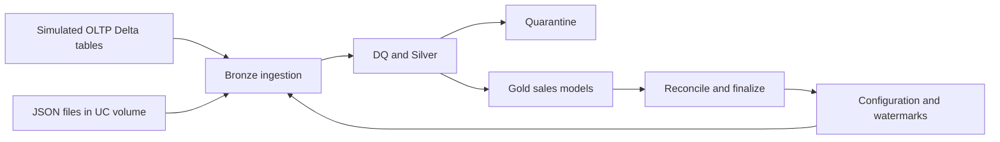

# Exercise 17 — EcomSphere: Application Execution and Code Exploration

## 1. Session introduction

- **Application ownership:** deploy an existing application, execute it and investigate its results.
- **Metadata-driven ingestion:** control the extraction process through dataset configuration instead of a separate script for every table.
- **Runtime parameters:** choose the source batch when running a job; deployment variables identify the lab namespace.
- **Code navigation:** follow a job task into its script and imported functions. Use this skill in the independent assignment.

**Practical outcome:** three completed Databricks job runs, with verified sales of ₹220, ₹330 and ₹440; then an independently prepared application flowchart.

## 2. Application skeleton



The wider EcomSphere design defines 56 database objects and 50 quality rules. This runnable lab implements six relational sources (`customer`, `product_variant`, `orders`, `order_item`, `payment`, `shipment`), one JSON event feed, selected quality checks, customer history, trusted sales, an OBT and a daily mart. Silver and Gold use lab-specific column projections. The complete design contracts are retained in `config/` for later expansion. External systems are simulated; Spark, Delta, Unity Catalog volumes and the job execution are real Databricks components.

### Repository map

| File or directory | Responsibility |
|---|---|
| `databricks.yml` | Bundle target and deployment variables |
| `resources/jobs.yml` | Master job, task dependencies, reset job |
| `notebooks/task.py` | Job entry point and stage dispatch |
| `notebooks/ecomsphere/context.py` | Parameter checks, safe identifiers, SQL helpers |
| `notebooks/ecomsphere/contracts.py` | Typed source tables and lab resource definitions |
| `notebooks/ecomsphere/fixtures.py` | Three deterministic source snapshots and expected outcomes |
| `notebooks/ecomsphere/setup.py` | Create resources and initialize metadata |
| `notebooks/ecomsphere/simulate.py` | Apply source snapshot and write JSON arrival |
| `notebooks/ecomsphere/ingestion.py` | Relational CDC and file streaming |
| `notebooks/ecomsphere/silver.py` | Deduplication, quality checks and trusted projections |
| `notebooks/ecomsphere/gold.py` | Customer history, sales fact, OBT and mart |
| `notebooks/ecomsphere/operations.py` | Reconciliation, finalization, failure audit, reset |
| `notebooks/inspect.py` | Read-only SQL-based inspection notebook |
| `config/` | Original schema and DQ reference catalogs |
| `tests/` | Local fixture and safety checks |

The job's success path is `setup → generate_sources → bronze_ingestion → quality_and_silver → gold_modeling → reconciliation → finalize`. A separate `record_failure` task handles upstream failures. Discover the detailed function calls during the assignment.

## 3. Start here — deploy the application

### Step 1 — Local repository

Use Windows Git Bash. Install the modern Databricks CLI and GitHub CLI if not already installed. Python 3 is needed only for the optional local tests.

```bash
mkdir -p /d/TG117/Projects
cd /d/TG117/Projects
gh auth status
```

If you have **not** created the repository, run:

```bash
gh repo create ecomsphere-databricks --private --clone
```

If it already exists but has not been cloned, use `gh repo clone OWNER/ecomsphere-databricks` (replace `OWNER` with your GitHub login or organization). If it is already cloned, skip both commands.

```bash
cd /d/TG117/Projects/ecomsphere-databricks
git status
git remote -v
```

Extract `Exercise_17_EcomSphere_Databricks_Application.zip` with Windows File Explorer. Copy the **contents** of its `ecomsphere-databricks` folder into your local clone (do not create a nested repository). For a nonempty repository, first commit or back up your earlier work, then integrate on a new branch; do not overwrite existing changes or delete `.git`.

```bash
ls -la
ls notebooks/ecomsphere
```

**Expected:** `databricks.yml`, `resources/`, `notebooks/`, `config/`, `tests/` and the existing `.git/` directory are visible. The bundle uses the files in this local directory, not a remote GitHub branch.

### Step 2 — Workspace and catalog

Open your Free Edition workspace. In **Catalog**, find an existing writable Unity Catalog catalog. You need permission to use the catalog and create schemas, tables and volumes in the lab namespace. The application does not create a catalog or grant itself privileges. Use your own catalog if `workspace` is unavailable. Do not use a shared namespace already occupied by another learner.

```bash
databricks version
databricks auth profiles
```

If the `FREE` profile is missing, create it using your actual workspace URL (copy it from your browser; replace the prompt value):

```bash
read -r -p 'Databricks workspace URL: ' HOST
databricks auth login --host "$HOST" --profile FREE
```

If an existing profile has another name, substitute that name below. In the same Git Bash window:

```bash
export DATABRICKS_CONFIG_PROFILE=FREE
databricks current-user me
databricks catalogs list
read -r -p 'Existing writable catalog name: ' CATALOG
export CATALOG
export PREFIX=ecomsphere17_dev
export BUNDLE_VARS="catalog=$CATALOG,prefix=$PREFIX"
```

On a shared workspace choose a unique `PREFIX` beginning with `ecomsphere17_` (lowercase letters, numbers and underscores) and rebuild `BUNDLE_VARS`. This guide assumes one learner controls one namespace. Retain the same catalog/prefix for all runs.

**Expected:** the CLI shows your intended identity and catalog. A missing permission must be corrected before the job can initialize its resources. No Azure SQL/ADLS credentials are necessary.

### Step 3 — Validate and deploy

```bash
databricks bundle validate -t dev --var="$BUNDLE_VARS"
databricks bundle deploy -t dev --var="$BUNDLE_VARS"
```

**Expected:** successful validation and deployment of the pipeline and reset jobs. Deployment uploads notebooks/modules and creates job definitions. Tables and volumes are created by the setup task when the pipeline runs, not by the bundle deploy command.

**Workspace:** open **Jobs & Pipelines** and select the deployed job ending in `ecomsphere-session17-pipeline`. Development mode may prepend your username. Inspect the Tasks graph. The first run will create the seven prefixed schemas (`_source`, `_bronze`, `_silver`, `_gold`, `_meta`, `_quarantine`, `_governance`), two managed volumes (`landing`, `checkpoints`) and lab tables. Existing owned resources are reused. The Silver/Gold outputs materialize in their processing tasks.

| Input | Example | When resolved |
|---|---|---|
| Bundle target | `dev` | Deployment |
| Bundle variables | `catalog`, `prefix` | Deployment |
| Job parameter | `batch=1`, `2` or `3` | Run time |
| Task parameter | `stage` | Job task definition |
| Dynamic reference | `{{job.run_id}}` | Each job run |
| Control table | `pipeline_config` | During ingestion |
| Persistent state | `cdc_watermark`, streaming checkpoint | Between executions |

## 4. Execute and verify three batches

Run the commands **one at a time**, waiting for each job to finish successfully before submitting the next. The three runs have different Databricks-generated job run IDs. A business record rejection does not necessarily mean the job itself failed.

### Run 1 — Initial load

**Before:** no committed batch; setup initializes the lab on the first execution.

```bash
databricks bundle run -t dev --var="$BUNDLE_VARS" --params batch=1 ecomsphere_pipeline
```

**Expected:** seven successful main tasks; `record_failure` is excluded/skipped on success. Two trusted lines (`OI001`, `OI002`) total ₹220. Two customers, one event, zero rejects. All six relational watermarks advance to `2026-08-20 10:00:00` UTC.

**Inspect the results:** open **Workspace** and navigate to the deployed bundle files under your user's `.bundle/ecomsphere-session17/dev/files/notebooks` directory; alternatively open the notebook link from a job task and navigate to its sibling `inspect` notebook. Open `inspect`, connect to serverless compute, run its first cell to create widgets, set `catalog` and `prefix` to the values used at deployment, then **Run all**. This is a read-only notebook. Keep it open for the next two runs. Its cells show counts, sales rows, dimension versions, rejects, audit and watermarks.

| Inspect metric | Run 1 expected |
|---|---:|
| `bronze_customer` / `bronze_orders` / `bronze_order_item` | 2 / 2 / 2 |
| `bronze_order_event_log` | 1 |
| `fact_sales_order_item` | 2 |
| `revenue_INR` | 220.00 |
| `current_rejects` / `reject_history` | 0 / 0 |
| `dim_customer` | 2 |

Verify that `O002` (grand total 110.01) is accepted and that O001's multiple payments/shipments still produce one line. The fact uses the line total, not the order header total.

### Run 2 — Incremental changes and rejection

**Before:** two sales lines and ₹220; last committed batch 1.

```bash
databricks bundle run -t dev --var="$BUNDLE_VARS" --params batch=2 ecomsphere_pipeline
```

Rerun **all** cells in `inspect` with the same widgets.

| Inspect metric | Before → after |
|---|---|
| Bronze customer / orders / items | 2/2/2 → 4/6/6 |
| Trusted sales lines | 2 → 3 |
| Revenue | ₹220 → ₹330 |
| Current rejects / historical rejects | 0/0 → 2/2 |
| Event rows | 1 → 2 |
| Customer dimension versions | 2 → 3 |
| Committed watermark | 10:00 → 11:10 UTC |

**Expected:** `C001` has a new normalized email and two historical dimension versions. `O003` is accepted; order `O004` has grand total ₹999 and is rejected (`DQ36_ORDER_TOTAL`). Its item `OI004` is also rejected (`ORDER_ITEM_ORDER_REFERENCE`). The job can complete successfully because those rejects are expected and trusted sales reconcile.

### Run 3 — Correction and recovery

**Before:** three trusted sales lines, two current rejects and ₹330.

```bash
databricks bundle run -t dev --var="$BUNDLE_VARS" --params batch=3 ecomsphere_pipeline
```

Rerun the `inspect` notebook.

| Inspect metric | Before → after |
|---|---|
| Bronze customer / orders / items | 4/6/6 → 5/8/8 |
| Trusted sales lines | 3 → 4 |
| Revenue | ₹330 → ₹440 |
| Current rejects | 2 → 0 |
| Reject history | 2 → 2 |
| Event rows | 2 → 3 |
| Customer dimension versions | 3 → 3 |
| Committed watermark | 11:10 → 12:00 UTC |

**Expected:** corrected `O004` (₹110) and its existing item `OI004` now appear in the trusted outputs. Previous reject evidence remains in the history. The audit shows three distinct successful job run IDs; six watermark rows have `last_committed_batch=3` and `pending_batch=NULL`.

### Optional — Replay and recovery

To replay the most recently committed batch, run the same `batch=3` command again and inspect. Expected business results and Bronze row counts remain unchanged; a new job run audit entry is expected. Do not replay older committed batches after a newer batch has been committed. If any task fails, open its **Output** in the Jobs run page, fix the identified issue and rerun the same pending batch; do not submit a later batch or manually advance watermarks. After a cancellation, inspect the Jobs status even if the custom failure audit is incomplete.

## 5. Optional cleanup — start again

Use only when the pipeline and all inspection writes (if any) are stopped. Reset is a **destructive lab operation**: it drops the named exercise-owned tables and both managed volumes, including input files, checkpoints, audit and reject history. Save required evidence first. The ownership marker, schemas, local source code, Git history and job definitions remain.

```bash
databricks bundle run -t dev --var="$BUNDLE_VARS" --params "confirmation=RESET_${PREFIX}" ecomsphere_reset
```

**Expected:** reset job reports completion; the schemas remain, but the lab tables (except `meta.lab_owner`) and the volumes are removed. In Catalog, refresh the lab schemas to verify. Start again with the `batch=1` command from section 4. Setup recreates the necessary resources. Never delete the checkpoint or watermark alone while retaining its corresponding data.

## 6. Establish the Git checkpoint

From the repository root, optionally verify the fixtures locally (no Spark installation required):

```bash
python -m unittest discover -s tests -v
```

**Expected:** six tests pass. These validate local fixtures and contracts, not the Databricks runtime.

```bash
git status --short
git add .gitignore README.md databricks.yml config notebooks resources tests
git diff --cached --stat
```

On the empty cloned repository, ensure the first branch is `main` (use `git branch -M main` only before the first commit if necessary). On an existing repository, keep the intended branch and use your normal PR workflow. Review staged files before committing.

```bash
git commit -m "Add Session 17 Databricks application baseline"
git push -u origin "$(git branch --show-current)"
```

If you used a feature branch, merge an approved PR through GitHub, then `git switch main` and `git pull --ff-only`. Only tag the approved baseline on `main`:

```bash
git status
git tag session-17-baseline
git push origin session-17-baseline
```

If you already committed/tagged a baseline, verify it rather than moving an existing tag or force-pushing. Use `git status`, `git log -1 --oneline`, `git ls-remote --tags origin session-17-baseline` and `gh repo view --web` to verify the checkpoint.

## 7. Independent exercise

Complete the separate **Exercise 17 — Student Assignment** after reproducing the three successful runs. Use the job definition, Python comments and read-only outputs to discover how the functions collaborate. Draw the function-level flowchart and answer the ten application-specific questions. Bring the diagrams and evidence to the code-review session.

### References

- [Free Edition limitations](https://docs.databricks.com/aws/en/getting-started/free-edition-limitations)
- [Bundle notebook tasks](https://docs.databricks.com/aws/en/dev-tools/bundles/job-task-types)
- [Bundle commands](https://docs.databricks.com/aws/en/dev-tools/cli/bundle-commands)
- [Streaming on serverless](https://docs.databricks.com/aws/en/compute/serverless/streaming)
- [Workspace Python modules](https://docs.databricks.com/aws/en/files/workspace-modules)
